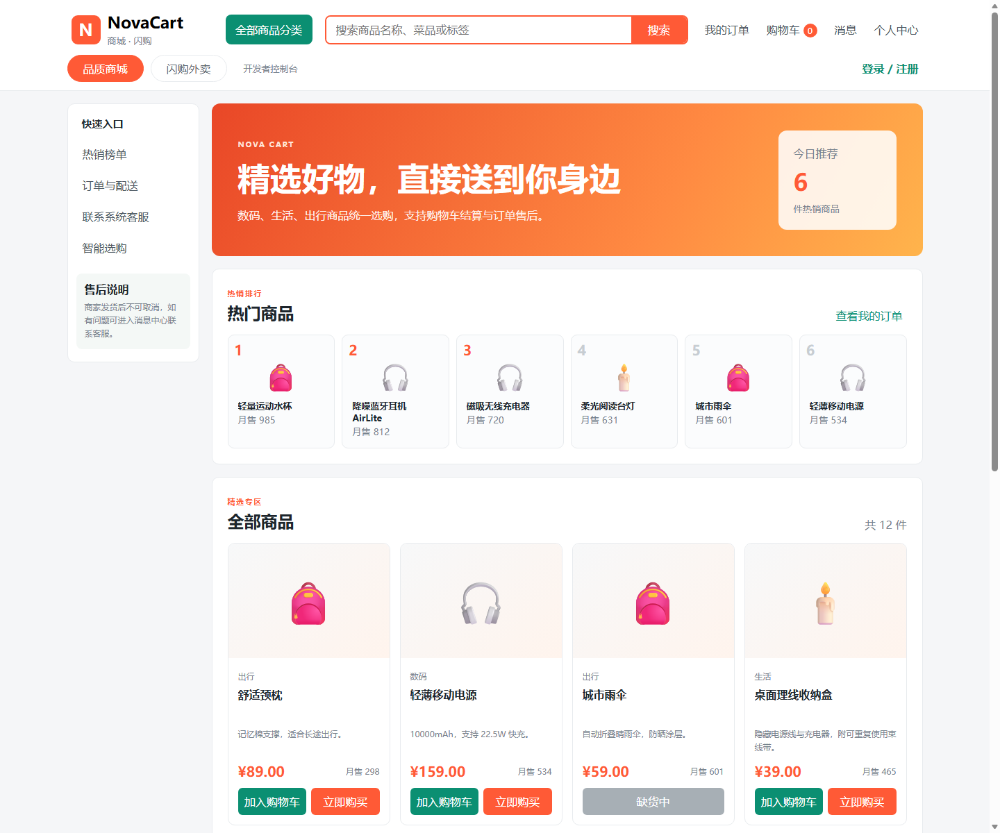

# NovaCart

[](https://www.java.com/)
[](https://spring.io/projects/spring-boot)
[](https://spring.io/projects/spring-ai)
[](https://github.com/pgvector/pgvector)

NovaCart 是一个融合品质商城与闪购外卖的 Java 全栈项目。项目参考苍穹外卖、
黑马商城和黑马点评的业务思路，但使用新的品牌、界面、领域模型、数据库与实现。



## 项目矩阵

- [LumaFeed](https://github.com/LongQz/LumaFeed)：本地生活内容社区
- [LumenPilot](https://github.com/LongQz/LumenPilot)：LangGraph 运营分析 Agent
- NovaCart：商城、闪购与 Spring AI 全栈项目

## 服务与地址

| 服务 | 端口 | 功能 |
|---|---:|---|
| `novacart-mall` | 8090 | 用户端、商品、外卖菜品、购物车、订单、评价、客服，并托管统一 AI 接口 |
| `novacart-ai` | 无独立端口 | 统一 AI 模块、工具调用、Prompt、商品 RAG；由 `novacart-mall` 托管运行 |
| `novacart-delivery` | 8091 | 商家接单、配送状态、WebSocket |
| `novacart-admin` | 8092 | 独立开发者端、商品管理、订单取消、客服回复 |

用户端：

```text
http://127.0.0.1:8090
```

开发者端：

```text
http://127.0.0.1:8092
```

## 测试账号

```text
普通用户：demo / 123456
普通用户：qzh / 123456
开发者：developer / admin123
```

## 用户端功能

- 用户名密码登录、Redis Token 和角色校验
- 顶部“我的订单、购物车、消息、个人中心”导航
- 24 个商城商品和外卖菜品，包含销量、热点排行
- 缺货商品自动显示“缺货中”
- 商城购物车支持收货人、电话、加减数量和删除
- 外卖菜品直接购买，不经过购物车
- 确认订单弹窗、独立收银台、模拟支付、支付成功页
- 用户取消订单，订单取消后自动回补库存
- 外卖状态：待商家接单、待商家发货、已发货、送货中、已到达
- 已发货禁止取消，发货前允许取消
- 商城支付后、外卖到达后可评价
- 系统客服消息和售后沟通
- Spring AI 推荐、订单草稿、实时配送状态和商品 RAG

## 开发者端功能

- ADMIN 角色登录校验
- 运营数据总览
- 商品改价、库存调整、上架与下架
- 全量订单查询
- 系统客服取消订单并回补库存
- 推进外卖配送状态
- 查看用户客服会话并回复

## 技术栈

- Java 17、Spring Boot
- Spring Cloud OpenFeign、LoadBalancer、Nacos Discovery
- MyBatis-Plus、MySQL
- Redis、Spring Cache
- RabbitMQ、Spring Task
- WebSocket / STOMP
- Spring AI、阿里云百炼 `qwen4-max`、`text-embedding-v3`、PostgreSQL + pgvector
- Java HttpClient、HTML/CSS/JavaScript

## 统一 AI 模块

Spring AI 代码位于独立的 `novacart-ai` 模块，不再属于商城包。该模块通过
`AiCommerceGateway` 访问商品、购物车、订单、配送和登录用户，商城模块只提供
适配器并在 `8090` 托管运行。这样 AI 代码边界与商城微服务边界分离，同时保留
同一套商品目录、权限和会话能力。

AI 工具同时支持：

- `MALL`：商城商品搜索、预算推荐、购物车和订单状态。
- `DELIVERY`：外卖菜品推荐、配送时间估算、订单状态和实时配送节点。

## 服务治理场景

### Sentinel

商品检索入口使用 `@SentinelResource`，异常时返回降级结果。Sentinel Dashboard
默认地址是 `127.0.0.1:8858`，未启动 Dashboard 不影响本地业务。

### Seata

商城支付创建配送任务、客服跨订单取消使用 `@GlobalTransactional`。默认本地运行
关闭 Seata 服务；启用 Seata Server 后设置：

```dotenv
NOVACART_SEATA_ENABLED=true
```

### RabbitMQ

商城支付后发布 `order.paid` 事件，外卖服务消费事件并幂等创建配送任务；OpenFeign
仍保留为同步调用和业务校验通道。

### Nacos

默认使用本地固定地址，启动 Nacos 后启用 `cloud` profile：

```text
spring.profiles.active=cloud
```

## 初始化数据库

```powershell
$env:MYSQL_PWD="<your-local-mysql-password>"
mysql --default-character-set=utf8mb4 -uroot -e "source sql/novacart.sql"
```

PostgreSQL：

```powershell
docker exec -e PGPASSWORD="<your-local-postgres-password>" lumenpilot-pg `
  psql -U lumenpilot -d postgres -c "CREATE DATABASE novacart"

docker exec -e PGPASSWORD="<your-local-postgres-password>" lumenpilot-pg `
  psql -U lumenpilot -d novacart -c "CREATE EXTENSION IF NOT EXISTS vector"
```

## 一键启动

```powershell
.\scripts\start-local.cmd
```

脚本会自动启动 Docker Desktop、PostgreSQL、商城、配送和开发者端。

停止：

```powershell
.\scripts\stop-local.cmd
```

## 测试

```powershell
mvn test
python scripts\smoke_test.py
python scripts\extended_test.py
```

覆盖：

```text
登录
→ Redis 购物车
→ 商城/外卖订单
→ 模拟支付
→ OpenFeign/RabbitMQ 配送
→ 物流推进
→ 评价
→ 发货后禁止取消
→ 客服取消
→ 客服回复
→ Spring AI 推荐
```

## 来源声明

项目业务思路来源于苍穹外卖、黑马商城和黑马点评课程项目。当前项目使用新的
NovaCart 品牌、Java 包名、页面、数据库与新增业务实现；新增源码作者标记为
`qzh`。详见 [NOTICE.md](NOTICE.md)。

## Author

LongQz
